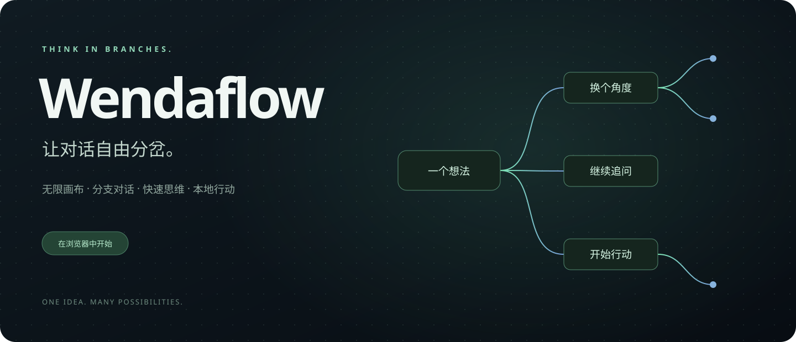
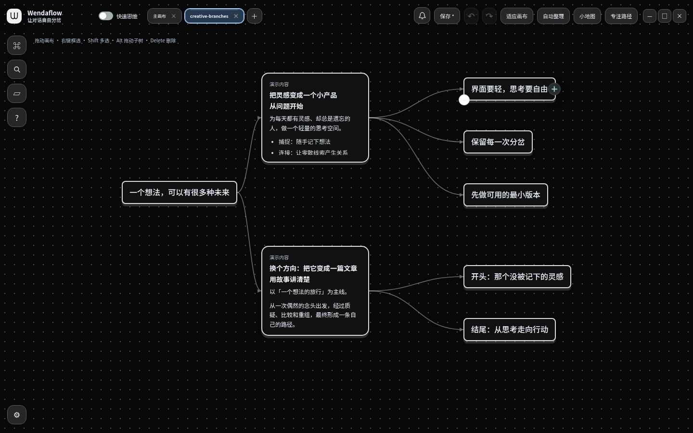
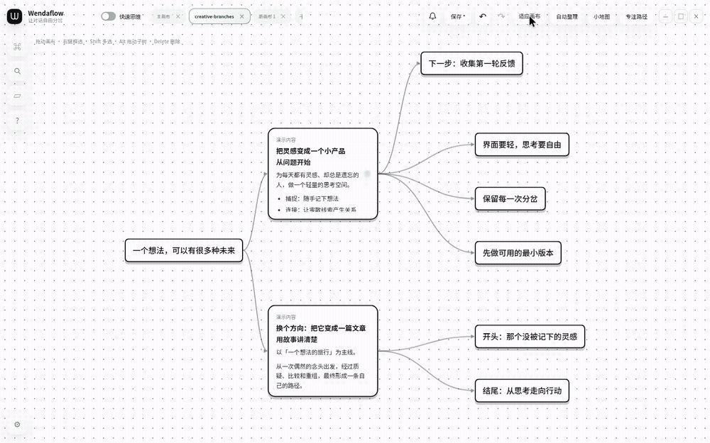
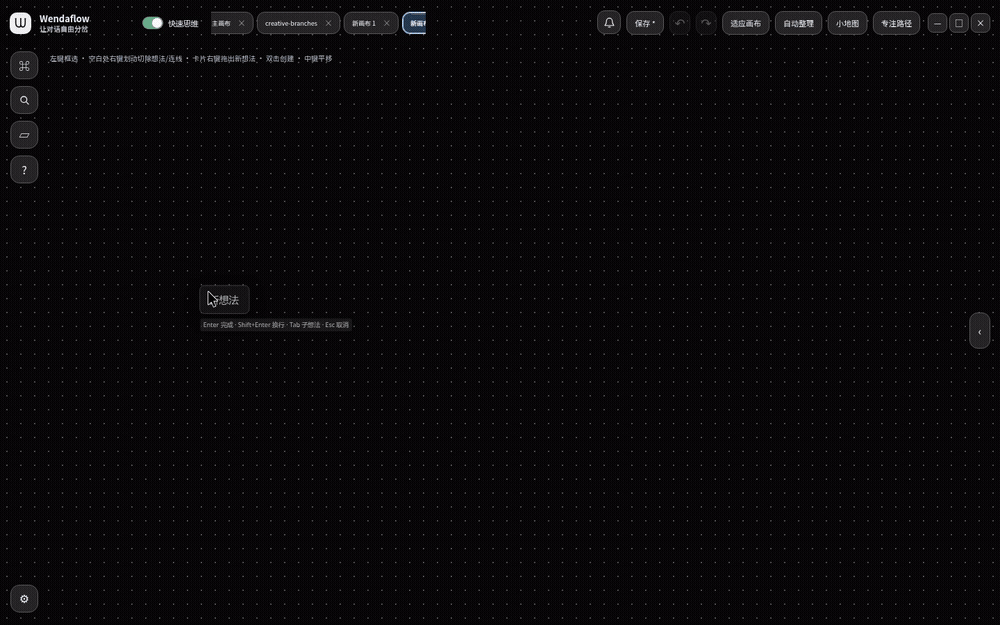
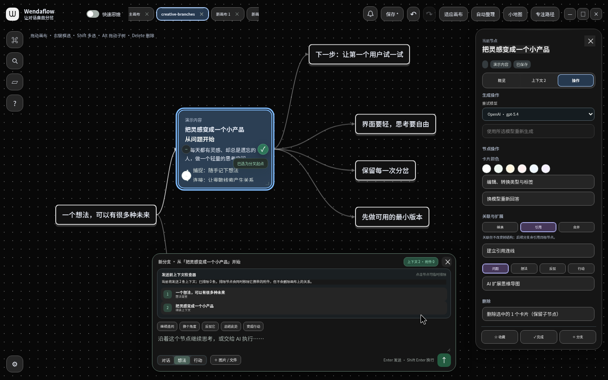
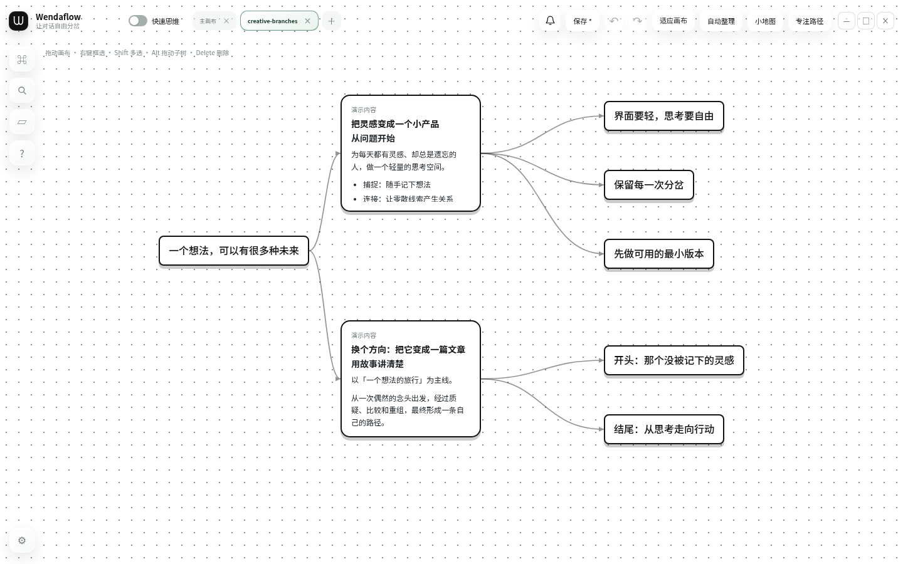
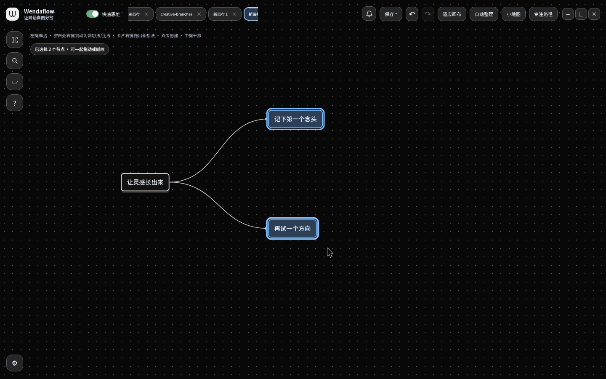

<div align="center">



**把一个问题，展开成一整片可能。**

在无限画布上，与 AI 对话、记录灵感、连接思路，让想法继续走向行动。

[开始使用](#快速开始) · [操作演示](#看看它如何工作) · [下载示例画布](docs/examples/creative-branches.wdf) · [反馈与建议](https://github.com/pyrider3/Wendaflow/issues)

`WEB FIRST`　`MULTI-MODEL`　`LOCAL OLLAMA`　`WDF`　`AGPL-3.0`

</div>



> 同一个起点，可以做产品，也可以写文章。每条路径都留在画布上，随时回去继续。

## 看看它如何工作

### 01 / 对话可以分岔，思路可以回头

从任意节点继续，查看这次请求将继承的上下文，再把下一步留成一个新分支。



### 02 / 打开快速思维，让手跟上脑子

双击落下一个念头，右键拖出父子关系，左键框选，再划掉不需要的方向。操作后也能撤销。



### 03 / 你决定 AI 看见什么

发送前展开上下文检查器，确认本次分支继承哪些节点和附件。



### 04 / 白天清晰，夜里沉浸

内置多种主题，画布内容不变，换一种适合此刻的工作氛围。

| 极昼 | 极夜 |
| :---: | :---: |
|  |  |

<details>
<summary><strong>查看快速思维静态截图</strong></summary>



</details>

**亲手试一试：** 下载 [灵感分岔示例 WDF](docs/examples/creative-branches.wdf)，在「所有画布 → 导入 WDF」中打开。

<sub>以上为当前网页版的真实界面与操作录制。画布文字为专门制作的示例内容，非实时模型生成；演示没有调用付费模型。</sub>

## 一张画布，三种工作方式

| 对话 | 想法 | 行动 |
| --- | --- | --- |
| 与云端或本地模型交流，从任意历史节点继续 | 无需 AI 回复，随手捕捉并连接灵感 | 连接本地执行器，将任务推进到文件与产物 |

## 快速开始

准备好 Node.js 和 npm，在本机浏览器中运行：

```bash
git clone https://github.com/pyrider3/Wendaflow.git
cd Wendaflow
npm ci
npm run app
```

打开 **[localhost:5173](http://localhost:5173/)** 即可使用。保持终端中的启动命令运行，它会同时启动网页前端与本机后端，无需启动 Electron。

创建画布，在空白处双击，写下问题或想法。使用 AI 对话前，请先在设置中配置模型服务，或连接本地 Ollama。

详细说明见 [网页版运行指南](WEB_START.md)。已有画布可以通过 `.wdf` 文件导入，更换浏览器前请先导出保存。

## 它解决什么问题

普通 AI 聊天是一条线：提问、回答、继续提问。它适合目标明确的任务，却不适合探索、设计、研究、写作和复杂项目。

真实思考会回头、分叉、合并、暂停，并在不同模型与本地任务间切换。Wendaflow 将这种非线性的过程变成可操作的空间：

* 每一轮内容都是节点，而不是不可回头的消息。
* 可从任一历史节点继续，自动继承所需上下文。
* 可并排比较不同模型、不同提示词与不同方案。
* 可把对话转为想法或行动，持续组织为思维网络。

## 核心体验

### 无限画布式 AI 对话

节点位于可缩放、平移的画布中。你可以拖动节点、调整大小、框选多个节点、整理布局，也可以缩小为预览模式，在大量分支中快速找到方向。

节点有三种基本类型：

* **对话**：向云端或本地模型提问并获得回复。
* **想法**：记录无需 AI 回答的灵感、判断和素材。
* **行动**：把任务交给本地 Agent 执行，并保存执行过程与产物。

### 从任何节点重新开始

点击节点旁的加号，或在空白处双击，即可创建新分支。新分支只继承真正需要的祖先上下文，而不是把整张画布不加选择地塞给模型。

发送前，可以在右侧上下文页查看本次请求会带上哪些节点、图片和文件，并临时排除不需要的内容。

### 多模型并存

Wendaflow 不绑定某一家模型服务。你可以同时配置并切换：

* OpenAI Responses 与 OpenAI-compatible 接口
* Anthropic Messages 接口
* Google Gemini 原生接口
* 火山方舟、DeepSeek、豆包等兼容接口
* 本地 Ollama 模型

每个节点会保留所用模型与请求记录，便于回看、对比和复现。

### 图片与文件成为上下文

可以把图片、PDF、PPTX、Word、Excel 等文件附加到节点。它们会随分支进入模型或本地 Agent 的工作上下文，并以文件卡片或图片预览的形式保存在画布中。

WDF 文件可以打包画布结构、节点内容和附件，方便在不同设备之间迁移。

### 本地行动工作台

行动模式可调用本地执行器，例如 Codex、Claude Code 与 DeepSeek Harness。

行动节点不仅显示最终回答，也会记录任务状态、执行事件、终端输出、工作目录变化和生成产物。生成的图片、文档、代码或其他文件会出现在行动节点的“产物”区域，可打开或下载。

## 节点关系与思维导图

除了自然的父子分支，Wendaflow 还支持三类明确关系：

|关系|用途|
|-|-|
|继承|目标节点成为当前节点的子分支，并继承上下文|
|引用|建立关联，但不改变原有树结构|
|合并|将多个节点作为后续分支的组合上下文|

你可以框选节点、连接节点，也可以框选连线后高亮并管理它们。AI 扩展思维导图会从当前节点生成问题、想法、反驳或行动建议；用户确认后才会真正创建节点。

## 快速思维

打开左上角的「快速思维」开关，专注记录想法，卡片按文字内容紧凑显示。

| 操作 | 说明 |
| --- | --- |
| 双击空白处 | 快速创建想法 |
| 左键拖动空白处 | 框选想法，接触卡片边界即可选中 |
| 从卡片按住右键拖到另一张卡片 | 创建父子关系 |
| 从空白处按住右键划过 | 切除划过的想法或连线 |
| 中键拖动 | 平移画布 |
| 鼠标滚轮 | 缩放画布 |

父子关系使用实线，引用关系使用虚线。

## 普通模式操作

|操作|说明|
|-|-|
|单击节点|选中节点，打开右侧操作栏|
|双击节点|在节点内部直接编辑标题和正文|
|单击空白处|取消选中并关闭右侧栏|
|双击空白处|从零创建新分支|
|拖动空白处|平移画布|
|鼠标滚轮|缩放画布|
|Shift + 单击|多选节点|
|按住右键拖动|框选节点；若只框到连线则进入连线管理|
|Alt + 拖动节点|连同其子树一起移动|
|Delete|删除选中的节点或连线|
|Ctrl + S|保存当前画布|
|Enter|发送输入内容|
|Shift + Enter|在输入框中换行|

## 数据与保存

* 画布可以保存为本地 .wdf 文件。
* WDF 是可迁移的完整项目文件，包含结构、内容和附件。
* 本机后端默认将应用数据保存在系统文档目录下的 `Wonderful` 文件夹。浏览器另有独立站点缓存，请定期导出 WDF 备份。
* 支持导入、导出、多个画布、画布重命名与已保存画布管理。

## 设计原则

Wendaflow 的目标不是把普通聊天窗口搬到画布上，而是让 AI 成为思维过程中的一个可分叉、可比较、可执行的节点。

* **不丢失路径**：每一个岔路都可以保留。
* **上下文可见**：知道模型到底看到了什么。
* **用户保持控制**：AI 生成建议，是否采用由用户决定。
* **从思考到行动**：想法可以继续转为可执行任务与真实产物。

---

Wendaflow · WDF  
让对话自由分岔。

## 开源与贡献

Wendaflow 以 [GNU Affero General Public License v3.0](LICENSE) 开源。你可以查看、运行、修改和分发代码，但必须遵守该协议，尤其是向网络用户提供修改版服务时对应的源码提供义务。

欢迎通过 Issue 报告问题或提出建议。准备提交代码前，请阅读 [CONTRIBUTING.md](CONTRIBUTING.md)；构建说明见 [docs/BUILDING.md](docs/BUILDING.md)，安全问题请遵循 [SECURITY.md](SECURITY.md)。

## 项目结构与开发

- `src/`：React 界面、画布与交互逻辑
- `server.mjs`：本地模型代理、文件保存与行动执行服务
- `canvas-storage.mjs`：画布持久化
- `electron-main.mjs`：保留的桌面入口
- `notification-server/`、`notification-manager/`：通知服务及管理工具
- `website/`：官网静态文件

```bash
npm test
npm run build
```

构建说明见 [docs/BUILDING.md](docs/BUILDING.md)。历史桌面安装包见 [Releases](https://github.com/pyrider3/Wendaflow/releases)。

## 更新记录

- [界面与框选修复](UI_FIXES_2026-10-29.md)
- [黑色主题可读性检查](BLACK_READABILITY_2026-10-27.md)
- [画布性能验证](PERFORMANCE_2026-10-25.md)
- [0.2.15 更新说明](RELEASE_0.2.15.md)
