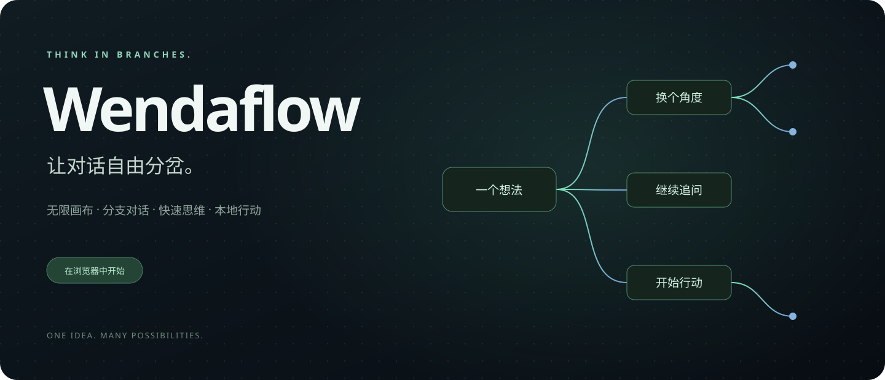
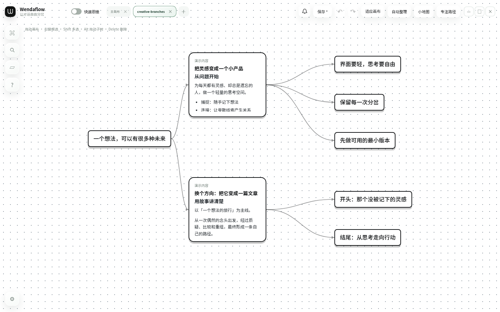
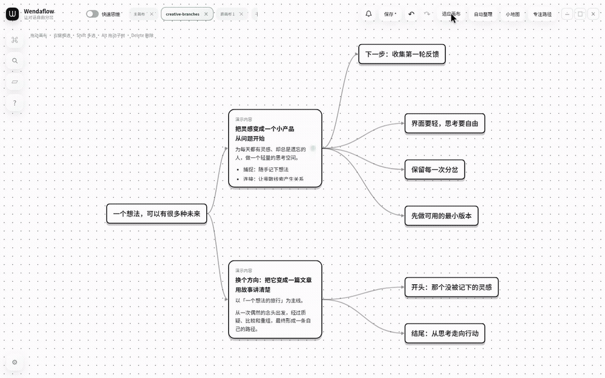
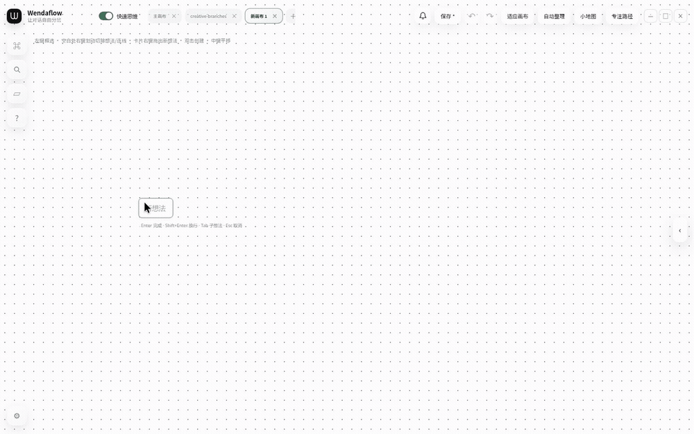
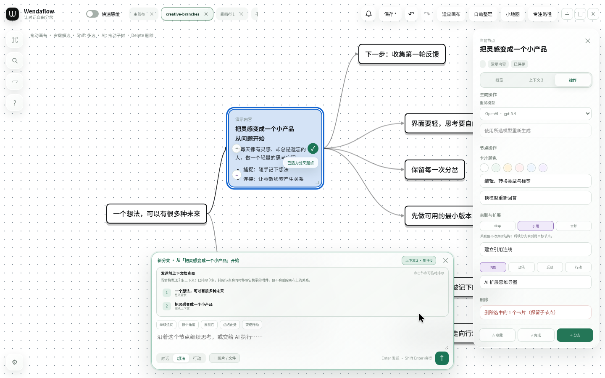
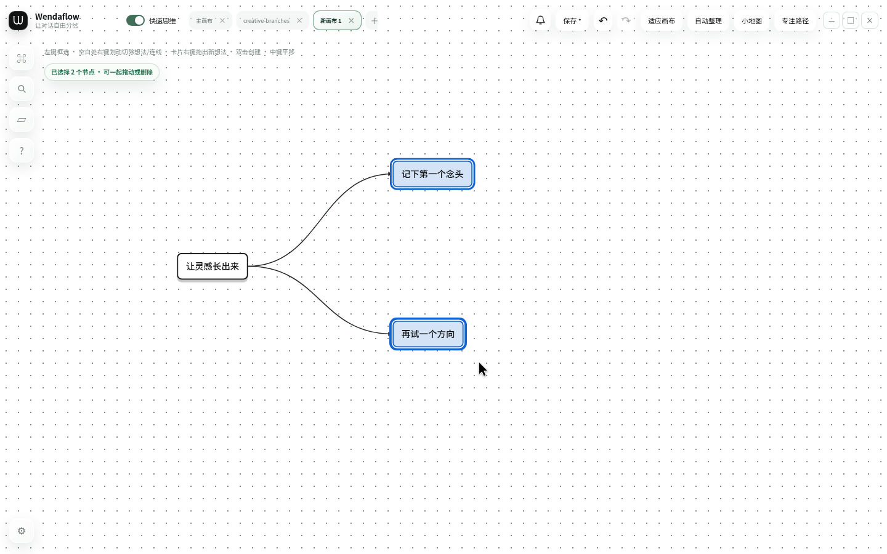

<div align="center">



**把一个问题，展开成一整片可能。**

在无限画布上，与 AI 对话、记录灵感、绘制结构图、连接多父分支，并把想法交给本地 Agent 推进到真实行动。

[开始使用](#快速开始) · [操作演示](#看看它如何工作) · [本地 Agent 工作台](#本地行动与-agent-工作台) · [下载示例画布](docs/examples/creative-branches.wdf) · [反馈与建议](https://github.com/pyrider3/Wendaflow/issues)

`WEB FIRST`　`MULTI-MODEL`　`MULTI-PARENT`　`LOCAL AGENTS`　`WDF`　`AGPL-3.0`

</div>



> 同一个起点，可以做产品，也可以写文章。每条路径都留在画布上，随时回去继续，或把多条分支重新汇合。

## 看看它如何工作

### 01 / 对话可以分岔，思路可以回头

从任意节点继续，查看这次请求将继承的上下文，再把下一步留成一个新分支。



### 02 / 打开快速思维，让手跟上脑子

双击落下一个念头，右键拖出父子连接（支持一卡多父节点），左键框选，再划掉不需要的方向。操作后也能撤销。



### 03 / 你决定 AI 看见什么

发送前展开上下文检查器，确认本次分支继承哪些节点和附件，并可临时排除不需要的内容。



<details>
<summary><strong>查看快速思维静态截图</strong></summary>



</details>

**亲手试一试：** 下载 [灵感分岔示例 WDF](docs/examples/creative-branches.wdf)，在「所有画布 → 导入 WDF」中打开。

<sub>以上演示均为网页版真实界面与操作录制，部分新功能（多父节点、AI 绘图、Pi 执行器、新主题等）请以当前 `main` 分支实际界面为准。</sub>

## 一张画布，四种工作方式

| 对话 | 想法 | 绘图 | 行动 |
| --- | --- | --- | --- |
| 与云端或本地模型交流，从任意历史节点分岔，支持多模型并行对比 | 无需 AI 回复，配合「快速思维」极速捕捉、组织并连接灵感 | 描述结构或流程，由 AI 流式生成多节点与连线（支持多父节点汇合） | 连接本地执行器（Pi / Codex / Claude Code / DeepSeek Harness），推进到真实文件与产物 |

## 快速开始

**在线体验：** [公开网页版](https://api.qnjyxh.xyz/)（每位访客自行配置模型密钥，画布保存在当前浏览器；本地行动执行器需在本机运行）。

新建画布在首次手动保存前属于临时草稿：切换标签会保留当前会话内容，关闭或刷新后丢弃。首次保存成功后启用该画布自动保存；已保存、导入、复制的画布关闭后仍保留。可随时导出 WDF 备份。

### 本机源码运行（推荐，支持本地模型与 Agent）

准备好 Node.js（20.19+ 或 22.12+）与 npm：

```bash
git clone https://github.com/pyrider3/Wendaflow.git
cd Wendaflow
npm ci
npm run app
```

打开 **[http://localhost:5173/](http://localhost:5173/)** 即可使用。保持终端命令运行，它会同时启动前端 Vite 与本机后端 `server.mjs`（默认端口 `4318`）。

- 详细运行说明见 [WEB_START.md](WEB_START.md)。
- 需要打包 **Windows 一键运行版（`Wendaflow.exe`）** 或部署公开版 / 个人云同步，见 [docs/BUILDING.md](docs/BUILDING.md)、[deployment/PUBLIC_WEB.md](deployment/PUBLIC_WEB.md) 与 [deployment/PERSONAL_CLOUD.md](deployment/PERSONAL_CLOUD.md)。

## 它解决什么问题

普通 AI 聊天是一条线：提问、回答、继续提问。它适合目标明确的单步问答，却不适合探索、设计、研究、写作和复杂工程。

真实思考会回头、分叉、汇合、暂停，并在不同模型与本地任务间切换。Wendaflow 将非线性思考变成可操作的空间：

- **路径不丢失**：每一轮内容都是独立节点，随时从任意节点再开分支。
- **上下文透明可控**：只继承上游祖先与显式关联分支，发送前可逐条检查或临时排除。
- **支持多父汇合**：多个思路分支可以共同汇聚到同一个子节点，并自动合并上下文。
- **从思考直达行动**：画布上的讨论结论可以直接交给本地 Coding Agent 执行并验收文件变更。

## 核心特性

### 多模型并存与并行比较

Wendaflow 不绑定单一服务商，可同时配置并切换：

- OpenAI Responses 与 OpenAI-compatible 接口（含 DeepSeek、火山方舟、豆包等）
- Anthropic Messages 接口
- Google Gemini 原生接口
- 本地 Ollama 模型

支持按模型配置推理强度 / 深度思考开关与创造性参数，支持同一节点开启多模型并行回复，每张卡片保留模型与请求记录。

### 多父节点与 AI 绘图

- **一卡多父节点**：单张卡片除主父节点外，可连接多个额外父节点；多个上游分支的文字与附件都会有序汇总到下游上下文，同时自动阻止循环依赖。删除或划断某一条父线时，其余父节点关系保持完好。
- **AI 绘图模式**：在输入框切换到「绘图」，描述想要梳理的流程图、架构图或知识结构，模型边流式输出边生成节点与连线，并支持一键 `Ctrl+Z` 整组撤销。
- **明确的关系网络**：除父子继承外，还支持「引用（虚线）」与「合并」关系、多选合并工作台，以及 AI 思维导图候选节点扩展。

### 本地行动与 Agent 工作台

行动模式默认不启用任何执行器；打开 **「设置 → 执行器」** 即可按需启用并配置默认工作目录：

- **Pi**（深度集成）：自动拉取 Pi 可用模型与分模型思考强度、通过 RPC 实时流式展示事件、支持运行中追加指令（steering）、执行前人工审批与放行规则（allow rules）、查看 Skills / MCP 列表，并支持从本机磁盘导入历史 Pi 会话，在画布上按分支 fork 继续对话。
- **Codex**、**Claude Code**、**DeepSeek Harness**：统一接入任务执行、工具调用事件、终端输出与产物展示。
- **工程验收能力**：支持 `@` 提及工作区文件、先制定计划再执行（Plan first）、隔离目录运行与文件变更快照 / 应用 / 回滚、A/B 双方案并排对比视图（CompareView）、顶部任务总览与桌面通知。

### 图片与文件上下文

支持拖拽、粘贴或上传图片、PDF、文档与代码文件到卡片；附件随分支进入模型或本地执行器上下文，并可在资料库中统一管理、复用或定位。

### 主题、多语言、移动端与导出

- **14 套预设主题 + 自定义配色**：雾青、珍珠、夜蓝、墨黑、极昼、极夜、星夜、黑曜、极光、暮光、深海、樱粉、薰衣草、沙丘。
- **11 种界面语言**：简体中文、繁體中文、English、日本語、한국어、Español、Français、Deutsch、Português、Русский、العربية（仅翻译软件界面，不改动你的卡片内容）。
- **手机端与 PWA**：适配移动端触控、双指缩放平移、底部导航栏与可安装 Web App。
- **多格式导出**：除可迁移的完整 `.wdf` 存档（及多画布 ZIP 打包）外，还支持直接导出 **PNG 图片、独立 HTML 网页、Markdown 大纲、SVG 矢量图**。

## 快速思维操作

打开左上角「快速思维」开关，卡片按文字内容紧凑显示，适合高密度头脑风暴与结构梳理：

| 操作 | 说明 |
| --- | --- |
| 双击空白处 | 创建新想法（`Enter` 完成，`Tab` 连续建子想法，`Ctrl / ⌘ + Enter` 建同级想法） |
| 方向键 / `F2` | 在相邻想法间切换选中 / 编辑当前想法 |
| 左键拖动空白处 | 框选卡片（`Shift + 框选` 追加，`Alt + 框选` 减去） |
| 从卡片右键拖到另一张卡片 | 建立父子连接；若目标已有父节点，**默认再加一个父节点（原父节点保留）** |
| `Alt` + 从卡片右键拖到已有父节点的卡片 | 改为移动分支（替换原主父节点） |
| 从卡片右键拖到空白处 | 直接拉出并新建子想法 |
| `Shift` + 从卡片右键拖动 | 建立引用虚线关系 |
| 从空白处右键划过 | 划断切除划过的想法或连线（可 `Ctrl+Z` 撤销） |
| 短按右键 | 打开快捷删除 / 新建菜单（`Esc` 关闭） |
| 中键拖动 / `空格 + 拖动` | 平移画布；滚轮缩放画布 |
| `?` | 打开快捷键帮助面板 |

## 普通模式操作

| 操作 | 说明 |
| --- | --- |
| 单击节点 | 选中节点（按 `I` 或点击右侧按钮打开/关闭卡片详情栏） |
| 双击想法卡片 | 原地编辑标题与正文（AI 生成卡片双击打开详情概览） |
| 拖动空白处 / 滚轮 | 平移画布 / 缩放画布 |
| `Shift` + 单击 | 切换多选节点 |
| 右键拖动空白处 | 框选节点；若仅框到连线则进入批量连线管理 |
| `Alt` + 拖动节点 | 连同其子树一起移动 |
| `Ctrl / ⌘ + K` | 搜索当前画布中的节点 |
| `Ctrl / ⌘ + S` | 保存当前画布 |
| `Ctrl / ⌘ + Z` / `Ctrl / ⌘ + Shift + Z` | 撤销 / 重做 |
| `Delete` / `Backspace` | 删除选中的节点或连线 |
| `Enter` / `Shift + Enter` | 发送输入内容 / 换行 |

## 数据与保存

- 画布支持保存为本地 `.wdf` 文件，完整打包节点结构、多父关系、内容与附件。
- 本机后端默认将存档保存在系统文档目录下的 `Wonderful` 文件夹（可通过环境变量 `WONDERFUL_DATA_DIR` 调整）；浏览器内另存有 IndexedDB 缓存，建议重要画布定期导出 `.wdf` 备份。
- 纯本地与开源形态，不包含赞助页或激活码/许可证校验，API 密钥与画布数据仅保存在当前设备。

## 项目结构与开发

- `src/main.jsx`：React 主应用与画布交互编排
- `src/canvas/`：文档规范化、多父图索引（`parents.mjs` / `graph-index.mjs`）、摄像机与几何增量更新、撤销历史、AI 绘图、导出（PNG/SVG/HTML/MD）与画布库管理
- `src/quick-thought/`：快速思维模式交互、连线、划切与快捷键帮助
- `src/cards/`：卡片视图、Markdown 记忆化渲染、行动工具事件与对比视图
- `src/agents/`：执行器目录、权限放行规则、`@` 文件提及、文件快照/回滚与 Pi 会话读取
- `src/components/`、`src/themes/`、`src/i18n/`、`src/cloud/`：面板组件、多主题样式、11 语言词表与个人云同步客户端
- `server.mjs`、`canvas-storage.mjs`：本机模型代理、WDF 持久化与本地 Agent 运行服务
- `scripts/`：国际化完整性审计（`audit-i18n.mjs`）、Playwright 检查脚本与 Windows 单文件打包（`scripts/windows/`）
- `deployment/`、`cloud/`、`notification-server/`、`notification-manager/`、`website/`：公开部署、个人云存储、通知服务与官网文件

运行全量测试与生产构建（构建会自动执行 11 语言 `audit:i18n` 校验与 Vite 分包构建）：

```bash
npm test
npm run build
```

更多构建与打包说明见 [docs/BUILDING.md](docs/BUILDING.md)。

## 开源与贡献

Wendaflow 以 [GNU Affero General Public License v3.0](LICENSE) 开源。你可以查看、运行、修改和分发代码，但必须遵守该协议，尤其是向网络用户提供修改版服务时对应的源码提供义务。

欢迎通过 [Issues](https://github.com/pyrider3/Wendaflow/issues) 反馈问题或建议。提交代码前请阅读 [CONTRIBUTING.md](CONTRIBUTING.md)，安全问题请参考 [SECURITY.md](SECURITY.md)。

## 历史记录文档

- [画布性能验证（2026-10-25）](PERFORMANCE_2026-10-25.md)
- [黑色主题可读性检查（2026-10-27）](BLACK_READABILITY_2026-10-27.md)
- [界面与框选修复（2026-10-29）](UI_FIXES_2026-10-29.md)
- [0.2.15 更新说明](RELEASE_0.2.15.md)
